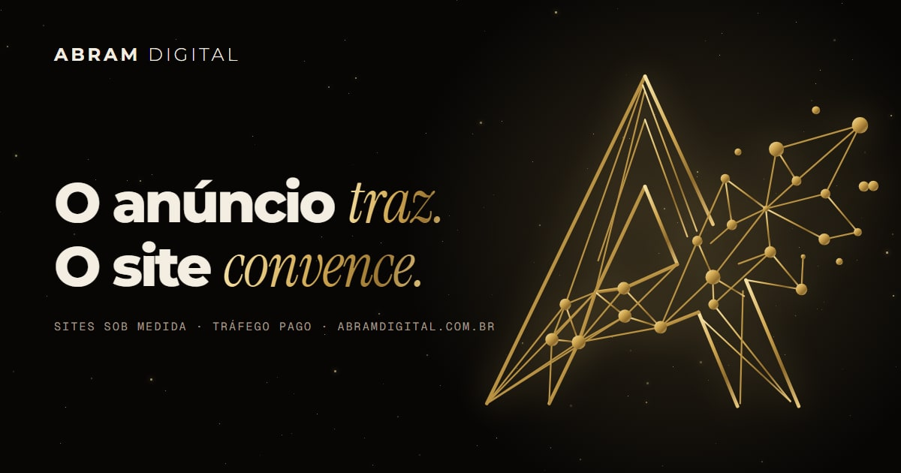

<p align="center">
  
</p>

<p align="center">
  
  
  
  
  
</p>

# Abram Digital

Site da **[Abram Digital](https://abramdigital.com.br)** — sites sob medida e
tráfego pago no Google e no Meta.

## O problema

Uma agência que vende site tem o pior problema de prova social que existe:
*todo mundo* diz que faz site bonito. Depoimento é texto que qualquer um
escreve; logo de cliente é imagem que qualquer um cola; "+300 projetos" é um
número que ninguém confere.

Então o site não pede para acreditar. Ele faz três coisas que dá para
conferir:

1. **É a demonstração.** A marca — um "A" em fios de ouro que se desfaz numa
   constelação — vira uma escultura 3D com dezenas de milhares de partículas
   que, conforme a rolagem, se transformam na janela de um site, no
   redemoinho de um funil de tráfego, num gráfico de medição, e voltam a ser
   o "A".
2. **Mostra o portfólio em movimento.** Cada site entregue aparece numa
   janela de navegador, em vídeo — gravado com a GPU de verdade, rolando a
   página, com o 3D e as animações de cada um rodando. Os que têm domínio
   próprio têm link. É só abrir.
3. **Mede a si mesmo, ao vivo.** Um painel lê a Navigation Timing e a
   Resource Timing do aparelho de quem visita: tempo até ficar pronta, peso
   transferido, pedidos, quadros por segundo da cena, domínios de terceiros
   (zero) e cookies (zero). Nenhum desses números foi escrito por alguém.

O argumento comercial — *o anúncio traz, o site convence; a gente faz as duas
metades* — se apoia em fatos do próprio Google (Índice de Qualidade, Core Web
Vitals, abandono no celular), cada um com a fonte linkada na tela.

## A constelação

### A marca virou um grafo

O símbolo chegou como JPEG. Para ele ser SVG, favicon, animação de abertura e
escultura 3D a partir de uma fonte só, foi retraçado ponto a ponto sobre uma
grade e conferido por sobreposição com o original. Saiu um grafo: 50 pontos,
65 fios (grossos no contorno da letra, finos na rede) e 26 nós.

```ts
// src/lib/marca.ts
export const FIOS: readonly (readonly [IdPonto, IdPonto, 0 | 1])[] = [
  ['topo', 'be', 1], ['be', 'bi', 1], ['topo', 'cd', 1], // o contorno do "A"
  ['N1', 'N2', 0], ['N1', 'N6', 0], ['N1', 'N9', 0],     // a rede
  // …
]
```

O mesmo grafo vira `<line>` + `<circle>` no SVG, cilindros e esferas de metal
na cena, e partículas distribuídas ao longo dos fios.

### Partículas que voam entre formas, sem a CPU mover nenhuma

Cada partícula tem uma posição em **todas** as formas
([`formas.ts`](src/scene/formas.ts)). A CPU só liga qual par de formas está
em uso (`aDe`, `aPara`, atributos já na GPU) e manda um número: o quanto da
mistura. O resto é do shader — e cada partícula decola no seu instante:

```glsl
float atraso = aSemente.x * 0.45;
float m = smoothstep(atraso, atraso + 0.55, uMix);
vec3 p = mix(girar(aDe, uGiroDe), girar(aPara, uGiroPara), m);
float voo = sin(3.14159 * m);           // no meio do voo, a curva
p += campo * (voo * 0.5 + uAgito * 0.22);
```

As primeiras `k` partículas são as grandes, e cada forma as põe nos seus
pontos importantes (os nós do "A", os cantos do navegador, os pontos do
gráfico): o desenho continua legível no meio da revoada.

Por cima, a **escultura**: os fios como cilindros instanciados de metal,
refletindo um estúdio de luz montado em código e passado pelo
`PMREMGenerator` — nenhum HDRI baixado. Quando a página sai da marca, cada fio
se recolhe (a direita primeiro, como o logotipo se desfaz) e a silhueta fica
só em pó.

O mouse abre caminho entre as partículas, o clique solta uma onda, o arrasto
gira a constelação. Rolagem rápida agita o pó.

### O contrato entre seções e cena

Cada seção marca a sua posição com `data-s`; [`estados.ts`](src/lib/estados.ts)
diz qual forma, onde, com que inclinação e opacidade. A cena interpola entre
os dois estados vizinhos do meio da tela, com um patamar para a forma assentar
antes da próxima.

## Decisões

| Decisão | Por quê |
|---|---|
| Um `Points` com shader próprio, não `InstancedMesh` de esferas | 36 mil esferas instanciadas custam geometria; ponto com *falloff* no fragmento custa um quadrado por partícula, e com mistura aditiva o brilho sai de graça |
| Sem pós-processamento (bloom) | ~20 kB e um passe de tela cheia a mais. O halo no próprio fragmento resolve |
| Escultura em `InstancedMesh` | Dois *draw calls* para 65 fios e 26 nós; o recolhimento é só matriz por instância |
| Sem `@react-three/drei` | ~250 kB de loaders que não seriam usados |
| Painel ao vivo em vez de depoimento | Número medido no aparelho de quem lê não envelhece e não precisa de fé |
| Diagnóstico sem formulário | Roda no navegador e vira mensagem de WhatsApp. Nada é enviado antes do toque |
| S3 website + Cloudflare, sem CloudFront | A Cloudflare já é CDN e TLS; as duas juntas eram redundância paga |
| Rotas com barra final | É o que o S3 serve sem redirecionar; canonical e sitemap seguem |

**Descartado:** HDRI baixado (2–8 MB de terceiro); modelo `.glb` do logo (o
grafo é menor e é a mesma fonte do SVG); vídeo de fundo no herói (pesa e não
reage).

## Dois bugs reais

**A cena "pulava" para fora da faixa sob carga.** Com a suíte de ponta a ponta
rodando em paralelo, um teste falhava às vezes com *Cannot read properties of
undefined (reading 'id')* — a pose de um estado inexistente. O carimbo de
tempo que o `requestAnimationFrame` entrega é o *início* do quadro, e pode ser
anterior ao `performance.now()` gravado ao ligar o laço. O `dt` saía negativo,
`0.08 ** -dt` passava de 1 e o amortecimento ultrapassava o alvo para trás:
estado −0,3, índice −1.

```ts
const dt = Math.min(0.064, Math.max(0, (agora - this.ultimo) / 1000))
```

**0/0 no pin do portfólio.** Durante a seção pinada, dois marcadores `data-s`
podiam ficar com o centro na mesma altura; a interpolação dividia zero por
zero e a cena recebia `NaN`. Hoje a distância mínima é testada
([`formas.test.ts`](tests/unit/formas.test.ts)) e a cena recusa progresso não
finito.

## Qualidade

- **Vitest** — SEO, rotas, marca, formas (finitas, determinísticas) e as
  **320 combinações** do diagnóstico: nenhuma com buraco, nenhuma prometendo
  número, prazo ou posição.
- **Playwright** contra o build de produção, desktop e celular, com o
  `vite preview` imitando o S3 (302 sem barra, 404 de verdade).
- **Biome**, **TypeScript strict**, **Knip**, **commitlint + lefthook**.
- **Caminho crítico: ~96 kB gzip** (limite de 170 no CI). three.js, GSAP,
  Lenis, Sentry e web-vitals sob import dinâmico.
- **Sentry e web-vitals** opcionais, desligados sem variável de ambiente.
  Nada de Datadog ou OpenTelemetry: não existe servidor para instrumentar.

## Infraestrutura

```
 visitante ──HTTPS──▶ Cloudflare (proxy) ── TLS, HTTP/3, cabeçalhos de segurança,
                          │                   /rota → /rota/index.html
                          │ HTTP
                          ▼
                    S3 static website  (bucket = domínio; só aceita os IPs da Cloudflare)
                          ▲
 GitHub Actions ── OIDC ──┘  credencial temporária de 1 h — sem access key em lugar nenhum
```

Push na `main` → lint, testes, build, publicação no S3 e smoke test no ar
(ver [`DEPLOY.md`](DEPLOY.md)).

## Rodando

```bash
npm ci
npm run dev          # http://localhost:5173
npm run build && npm run preview
npm run e2e
```

---

Desenvolvido por [Felipe Neiva](https://github.com/ffneiva).

## Licença e crédito

O **código** está sob a licença [MIT](LICENSE). A marca, as fotos, os vídeos e
os textos pertencem a **Abram Digital** — todos os direitos reservados; não podem
ser reutilizados sem autorização.

Desenvolvido por [Felipe Neiva](https://github.com/ffneiva) ·
[Abram Digital](https://abramdigital.com.br).
